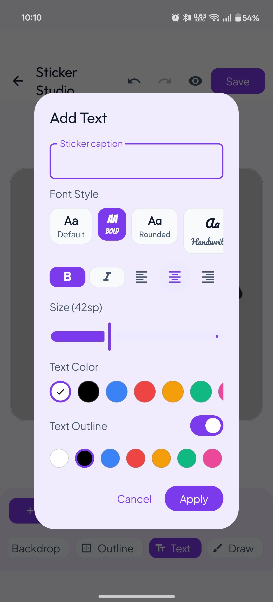
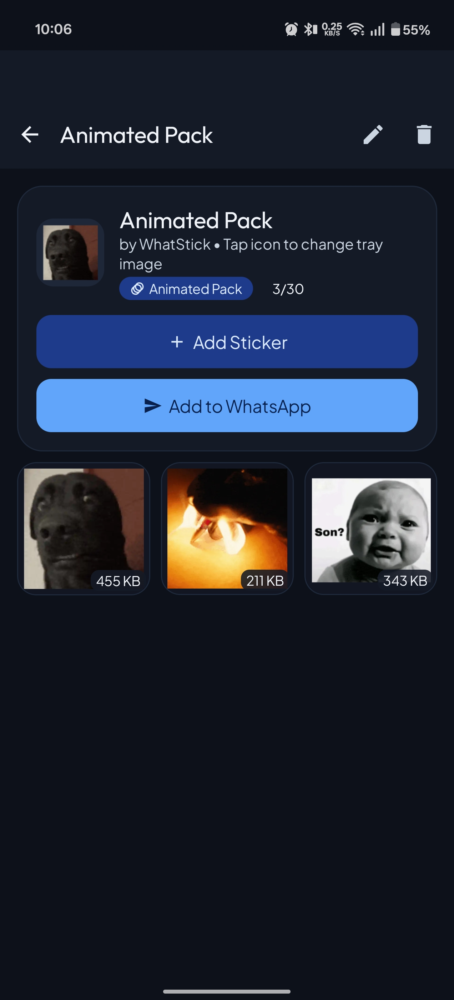
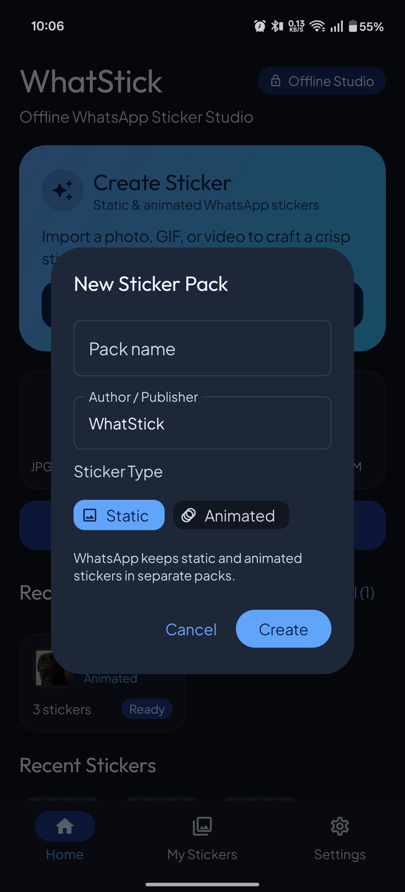
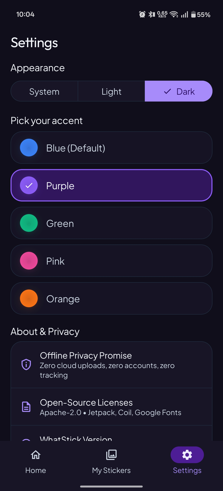

# 🎨 WhatStick

**Create your own WhatsApp stickers, right on your phone.**

WhatStick is an offline-first Android sticker maker for turning photos, GIFs and videos into custom WhatsApp stickers. Edit them, organize them into packs and add your creations to WhatsApp.

<p align="center">
  <strong>🖼️ Make it · ✂️ Customize it · 📦 Share it</strong>
</p>

## ⬇️ Download

Get the latest version from **[GitHub Releases](https://github.com/Barath702/WhatStick/releases/latest)**.

1. Download `WhatStick.apk` from the latest release.
2. Open the downloaded APK on your Android phone.
3. Allow installation from that source if Android asks.
4. Open WhatStick and start creating!

**Requirements:** Android 7.0 (API 24) or newer. To add sticker packs, WhatsApp or WhatsApp Business must be installed.

## ✨ What you can do

- 🖼️ **Create static stickers** from photos and images.
- 🎞️ **Make animated stickers** from GIFs and videos.
- ✂️ **Fine-tune your stickers** with crop, zoom, rotate, stretch and outline tools.
- 🖌️ **Make it yours** with text, fonts, drawing, erase and restore brushes, and Smart Object tools.
- 📦 **Organize sticker packs** and add them directly to WhatsApp.
- 🎨 **Personalize the app** with accent colours and Light, Dark or System themes.

## 📸 App screenshots

Take a look around WhatStick:

<table>
  <tr>
    <td align="center"></td>
    <td align="center"></td>
    <td align="center"></td>
  </tr>
  <tr>
    <td align="center"></td>
    <td align="center"></td>
    <td align="center"></td>
  </tr>
</table>

## 🛠️ How it works

1. **Choose media:** Pick a photo, GIF or video from your device.
2. **Edit:** Crop, adjust, add text or draw. Use the available tools to get the look you want.
3. **Save:** Add your finished sticker to a pack.
4. **Share:** Once your pack is ready, use **Add to WhatsApp** to import it.

## 📁 Supported formats

| Type | Formats |
|---|---|
| Images | JPG, JPEG, PNG, WebP, HEIC/HEIF* |
| Animated media | GIF, Animated WebP, MP4, WebM |
| Sticker export | WebP |

*HEIC/HEIF support depends on Android version and device codec support.*

## 🔐 Privacy first

- WhatStick is designed to work offline. Sticker editing and processing happen on your device.
- No account is required.
- Media is selected using Android's Photo Picker and file access tools.
- Your sticker files are stored in the app's private storage.

Read the full [Privacy Policy](PRIVACY.md).

## 🎨 Personalization

Choose from five accent colours:

🔵 Blue · 🟣 Purple · 🟢 Green · 🩷 Pink · 🟠 Orange

Use Light, Dark or System appearance to match your preference.

## 🧑‍💻 Build from source

Want to explore or build WhatStick yourself?

**Requirements**
- Android Studio (optional, for IDE-based development)
- JDK 17 or newer
- Gradle 9.3.1
- Android SDK Platform 36

**Build and test**

The repository includes `gradle/wrapper/gradle-wrapper.properties` configured for Gradle 9.3.1, but it does not currently include the Gradle Wrapper launchers (`gradlew`, `gradlew.bat`) or `gradle-wrapper.jar`. Therefore, the `./gradlew` commands will not work until those wrapper files are added.

For now, install Gradle 9.3.1 separately and run these commands from the project root:

```bash
# Run unit tests
gradle :app:testDebugUnitTest

# Run Android lint
gradle :app:lintDebug

# Build a debug APK
gradle :app:assembleDebug
```

To build a signed release APK, configure your signing credentials locally using the project's supported Gradle properties/environment variables. **Never commit keystores, passwords or signing credentials.**

## 🧰 Built with

- Kotlin and Jetpack Compose
- Material Design 3
- Room and DataStore
- Kotlin Coroutines and Serialization
- Coil

## 📄 License

WhatStick is licensed under the [Apache License 2.0](LICENSE).

---

**Made with ❤️ for sticker lovers.**
