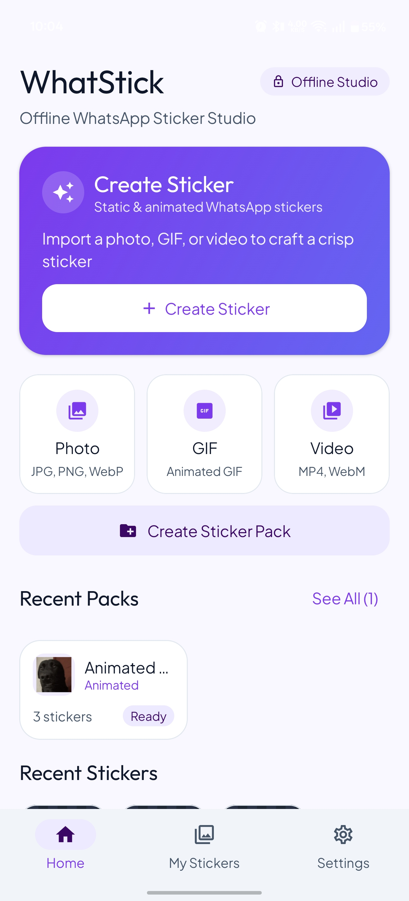
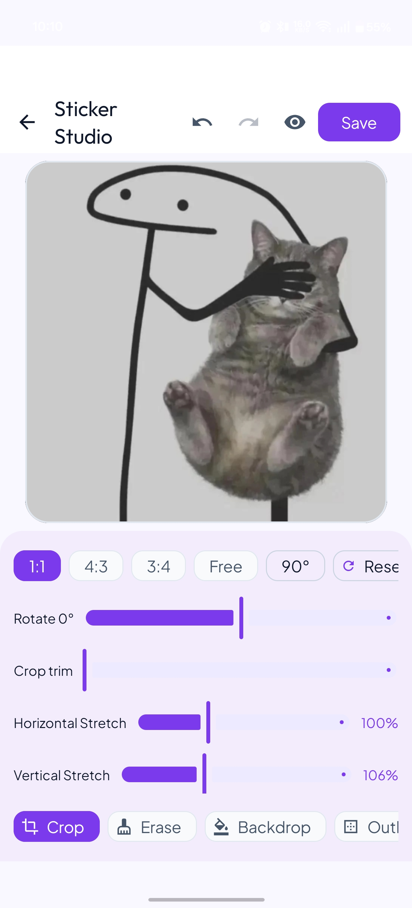

# 🎨 WhatStick

<p align="center">
  <strong>Your photos. Your ideas. Your stickers.</strong>
  <br />
  An offline-first sticker studio for Android.
</p>

<p align="center">
  
  
  
  
</p>

---

## ✨ Meet WhatStick

WhatStick is an Android sticker maker that turns photos, GIFs and videos into custom WhatsApp stickers. Create, edit and organize your stickers into packs, then add them to WhatsApp or WhatsApp Business.

No account. No complicated workflow. Just make something fun and share it.

## ⬇️ Download

<p align="center">
  <a href="https://github.com/Barath702/WhatStick/releases/latest">
    
  </a>
</p>

1. Open the [latest GitHub Release](https://github.com/Barath702/WhatStick/releases/latest).
2. Download `WhatStick.apk`.
3. Open the APK on your Android phone.
4. Allow installation from that source if Android asks.
5. Launch WhatStick and start creating!

**Requirements:** Android 7.0 (API 24) or newer. WhatsApp or WhatsApp Business is required to add sticker packs.

## 🧰 What can you create?

| Feature | What it does |
|---|---|
| 🖼️ **Static stickers** | Turn photos and images into stickers. |
| 🎞️ **Animated stickers** | Create stickers from GIFs and videos. |
| ✂️ **Editing tools** | Crop, zoom, rotate, stretch and add outlines. |
| 🖌️ **Text and drawing** | Add text with font options and draw on your stickers. |
| 🧽 **Erase and restore** | Refine your sticker edges with erase and restore brushes. |
| 📦 **Sticker packs** | Organize your creations and add packs directly to WhatsApp. |
| 🎨 **App themes** | Choose an accent colour and Light, Dark or System appearance. |

## 📸 Take a look

<p align="center">
  
  
  
</p>
<p align="center">
  
  
  
</p>

## 🪄 From media to sticker

1. **Choose** a photo, GIF or video from your device.
2. **Customize** it with the available editing tools.
3. **Save** your creation into a sticker pack.
4. **Share** it by using **Add to WhatsApp**.

## 📁 Supported formats

| Media | Formats |
|---|---|
| Images | JPG, JPEG, PNG, WebP, HEIC/HEIF* |
| Animated media | GIF, Animated WebP, MP4, WebM |
| Sticker export | WebP |

*HEIC/HEIF support depends on Android version and device codec support.*

## 🔒 Privacy by design

- **Offline-first:** Sticker editing and processing are designed to happen on your device.
- **No account required:** Open the app and get creating.
- **Your media, your choice:** Select media using Android's Photo Picker and file access tools.
- **Private storage:** Sticker files are stored in the app's private storage.

Read the [Privacy Policy](PRIVACY.md) for more information.

## 🎨 Make the app yours

Pick an accent colour:

🔵 Blue &nbsp; 🟣 Purple &nbsp; 🟢 Green &nbsp; 🩷 Pink &nbsp; 🟠 Orange

Choose **Light**, **Dark** or **System** appearance.

## 🧑‍💻 Build from source

Want to explore the code or build WhatStick yourself?

### Requirements

- Android Studio (optional, for IDE-based development)
- JDK 17 or newer
- Gradle **9.3.1**
- Android SDK Platform 36

### Build and test

The repository includes `gradle/wrapper/gradle-wrapper.properties` configured for Gradle 9.3.1, but does not currently include the Gradle Wrapper launchers (`gradlew`, `gradlew.bat`) or `gradle-wrapper.jar`. The `./gradlew` commands will therefore not work until those files are added.

For now, install Gradle 9.3.1 separately and run these commands from the project root:

```bash
# Run unit tests
gradle :app:testDebugUnitTest

# Run Android lint
gradle :app:lintDebug

# Build a debug APK
gradle :app:assembleDebug
```

To build a signed release APK, configure your signing credentials locally using the project's supported Gradle properties or environment variables. **Never commit keystores, passwords or signing credentials.**

## 🧱 Built with

- Kotlin and Jetpack Compose
- Material Design 3
- Room and DataStore
- Kotlin Coroutines and Serialization
- Coil

## 📄 License

WhatStick is licensed under the [Apache License 2.0](LICENSE).

---

<p align="center">
  <strong>💙 Made for sticker lovers. Built for creativity.</strong>
</p>
